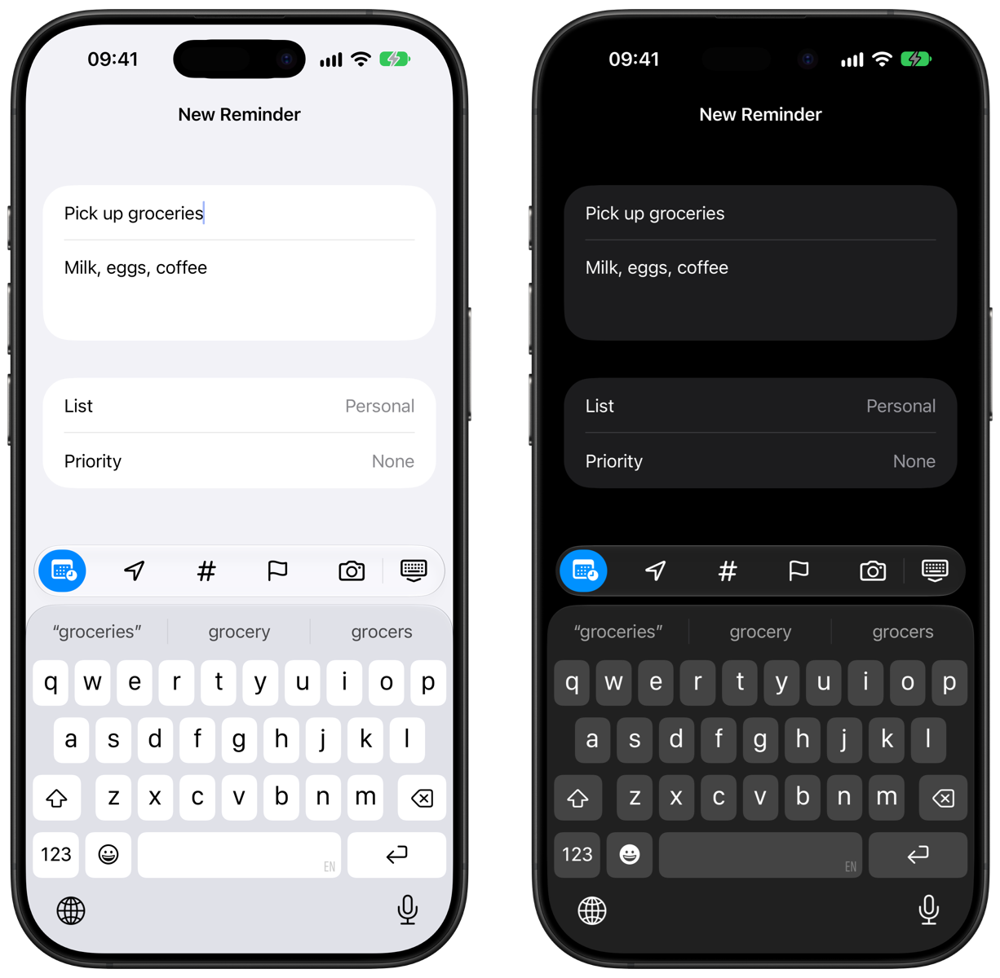

# KeyboardToolbar
A SwiftUI Toolbar for your iOS keyboard.

<p align="center">
  
</p>

Live examples are available as Xcode previews in `KeyboardToolbar.swift` and `KeyboardToolbarModifier.swift`.

The toolbar floats above the keyboard as a capsule. It uses Liquid Glass on iOS 26 and later, and a bar material on earlier versions. When the items fit, they spread across the full width like the system keyboard toolbar; otherwise they scroll.

## Installation

Supports iOS 17.0+. Requires Swift 6 (Xcode 16+). Xcode 26+ is needed to build with Liquid Glass.

### Swift Package Manager

Add `https://github.com/no-comment/KeyboardToolbar` to your [Package Dependencies](https://developer.apple.com/documentation/xcode/adding_package_dependencies_to_your_app).

## Usage

The KeyboardToolbar can contain multiple `KeyboardToolbarItem`s you provide.
You can additionally style the toolbar (background, size, spacing, etc.) via a `KeyboardToolbarStyle`.

```swift
import KeyboardToolbar

struct ContentView: View {
    @State private var text = ""
    @State private var isBold = false

    var body: some View {
        NavigationStack {
            Form {
                TextField("Input", text: $text)
            }
            .keyboardToolbar([
                .init(systemName: "bold", isSelected: isBold, accessibilityLabel: Text("Bold")) { isBold.toggle() },
                .init(systemName: "italic", accessibilityLabel: Text("Italic")) {},
                .init(systemName: "underline", accessibilityLabel: Text("Underline")) {},
                .dismissKeyboard
            ])
        }
    }
}
```

## API

### `.keyboardToolbar(_:style:)`

| **Parameter** | **Type**                | **Optional** | **Description**                                              |
| ------------- | ----------------------- | ------------ | ------------------------------------------------------------ |
| `items`       | `[KeyboardToolbarItem]` | No           | The items the toolbar contains. The toolbar is hidden when empty. |
| `style`       | `KeyboardToolbarStyle`  | Yes          | The styling of the toolbar. Defaults to `.standard`.          |

Attach it to the outermost view of a screen (e.g. the `Form` inside a `NavigationStack`). The toolbar is added as a bottom safe area inset, so scroll views keep the focused field visible above it.

### KeyboardToolbarItem

Items show an SF Symbol (`systemName:`), an asset (`imageName:`), a custom `Image` (`image:`) or text (`text:`). All initializers share these parameters:

| **Parameter**        | **Type**                     | **Optional** | **Description**                                              |
| -------------------- | ---------------------------- | ------------ | ------------------------------------------------------------ |
| `color`              | `Color?`                     | Yes          | Foreground color. Defaults to the primary color.             |
| `isFixed`            | `KeyboardToolbarEdge?`       | Yes          | Pins the item so it doesn't scroll: `nil`, `.leading` or `.trailing`. |
| `isSelected`         | `Bool`                       | Yes          | Highlights the item with a filled capsule, e.g. for an active mode. |
| `accessibilityLabel` | `Text?`                      | Yes          | VoiceOver label. Recommended for image items.                |
| `callback`           | `@MainActor () -> Void`      | No           | Action performed when the item is tapped.                     |

#### Presets

- `.dismissKeyboard`: A button pinned to the trailing edge that dismisses the keyboard.

### KeyboardToolbarStyle

| **Property**          | **Type**         | **Default**              | **Description**                                              |
| --------------------- | ---------------- | ------------------------ | ------------------------------------------------------------ |
| `background`          | `Background`     | `.glass`                 | `.glass`, `.tintedGlass(Color)` or `.color(Color)`.          |
| `height`              | `CGFloat`        | `48`                     | Height of the capsule.                                       |
| `itemSize`            | `CGFloat`        | `20`                     | Point size of icons.                                         |
| `itemSpacing`         | `CGFloat`        | `8`                      | Minimum spacing between items.                               |
| `font`                | `Font`           | `.body.weight(.medium)`  | Font of text items.                                          |
| `selectionColor`      | `Color?`         | accent color             | Fill behind selected items.                                  |
| `margins`             | `EdgeInsets`     | 8 sides, 8 bottom        | Distance to the screen edges and the keyboard.               |
| `distributesItems`    | `Bool`           | `true`                   | Spreads items across the width when they fit.                |
| `dividerColor`        | `Color`          | separator                | Color of the dividers.                                       |
| `dividerWidth`        | `CGFloat`        | `1`                      | Width of the dividers.                                       |
| `dividerBetweenItems` | `Bool`           | `false`                  | Adds dividers between every item, not just around pinned groups. |

Every property is mutable and has a matching `with…` builder, e.g. `.standard.withHeight(56).withDividerBetweenItems()`.

#### Presets

- `.standard`: Liquid Glass capsule.
- `.contrast`: Opaque capsule.
